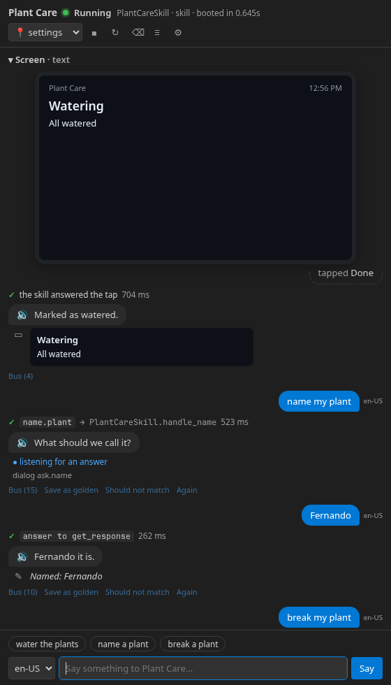

# Thalovant Skills for VS Code

Write a Thalovant skill and try it as you write it. The simulator runs your
skill next to the code in a real OVOS core, with the skill's own Python. Type
what someone would say, and see every way the skill answers:

- **🔊 what the speaker says**, and the SSML twin, if the dialog has one;
- **✎ what an app or a screen writes** (`speak_to(..., written=...)`);
- **▭ the card a screen shows**, on a simulated Mark II screen, with buttons
  that tap back into the skill;
- **which intent and handler took the sentence**, or who took it instead, or
  that nobody did;
- the skill's own log lines, warnings, exceptions (with a link to the line
  that raised) and every bus message.

Save a file and the skill restarts with your change. The conversation stays
on screen.



## Getting started

Open a folder that holds a skill (a `thalovant_skill_*` package, as
`thalovant-skillkit new` writes it). Then click ▷ in the editor title, or press
<kbd>Ctrl</kbd>+<kbd>Alt</kbd>+<kbd>V</kbd>.

No skill yet? Run **Thalovant: New Skill…**. It asks for a name and where the
skill sits in the fallback ladder. It then creates the skill with its own
`.venv`, with SkillKit and OVOScope installed and its tests passing, and opens
it in the simulator.

The skill runs with its tests' Python: `thalovant.python` if set, then the
skill's `.venv`, then the Python extension's interpreter. If that Python lacks
`thalovant-skillkit[testing]`, the simulator offers **Set up the environment**.
It installs the kit and the skill into the skill's `.venv` and changes nothing
outside the skill folder.

## What else it does

**Golden utterances in the Testing view.** Rows in
`test/end2end/golden_utterances*.jsonl` are tests, in the fleet's format:

```json
{"skill_id": "thalovant-skill-plant-care.thalovant", "utterance": "water the plants", "intent_label": "water.plants.intent", "lang": "en-US"}
```

A row passes when the sentence reaches this skill, and the intent when the row
names one. A failing row says who took the sentence instead. `"negative": true`
marks a sentence the skill must leave alone. In the simulator, **Save as
golden** and **Should not match** add the turn as a row.

**Code that knows the locale tree.** Inside `speak_dialog("…")`,
`mentions(utterance, "…")`, `@intent_handler("…")` and
`display.layout_file(self, "…")` you get:

- completion of the skill's names;
- a hover with each locale's lines and the locales that lack the file;
- go to definition;
- a warning for a name no locale has.

Over each handler and each intent line, a lens says one of the intent's
sentences.

**SkillKit checks on save.** `thalovant-skillkit check` runs when you save, and
its problems appear in the Problems panel on the file and line they name: a
missing translation, placeholders that differ, a pipe outside a group.
**Thalovant: Check the Skill Against the Fleet** compares this skill's
sentences with every other skill's.

**The Skill view.** In the activity bar: the skill's id and class, its locales
with what each lacks, its intents, dialogs, vocabulary and layouts.

## Good to know

- The simulator walks a sentence through stop, converse, Adapt, Padatious and
  every fallback tier (`thalovant.simulator.pipeline: "local"`). The hub also
  routes with the fleet's model2vec classifier: set `"m2v"` to route that way,
  which downloads the model on first use. A sentence that another skill
  already claims is caught by the fleet check, not by the simulator, because
  the simulator loads only your skill.
- A layout card (`.rfwtxt`) is drawn by the satellite's own widget library.
  The simulator shows what a screen that cannot draw it shows: the card's
  `body`, and the data bound to it.
- The skill runs your code, so the simulator, checks and tests need a trusted
  workspace. Completion, hover and highlighting work in restricted mode too.
- The location sent with each sentence comes from `thalovant.simulator.location`
  or the 📍 menu. Settings the skill starts with come from
  `thalovant.simulator.skillSettings`.
- Replies can be read aloud with `thalovant.simulator.speech: "system"`, where
  the editor offers speech synthesis. The microphone is not available in an
  editor panel, so you talk by typing.

## Settings

| Setting | Default | |
|---|---|---|
| `thalovant.python` | | The Python that runs the skill. `${skillFolder}` and `${workspaceFolder}` are expanded. |
| `thalovant.simulator.pipeline` | `local` | `local` or `m2v` (the hub's classifier). |
| `thalovant.simulator.reloadOnSave` | `true` | Restart the skill when one of its files is saved. |
| `thalovant.simulator.languages` | `[]` | Languages the hub loads; empty means `locale/supported.json`. |
| `thalovant.simulator.location` | `null` | The location in each sentence's context. |
| `thalovant.simulator.skillSettings` | `{}` | The skill's settings at start. |
| `thalovant.simulator.speech` | `off` | `system` reads replies aloud. |
| `thalovant.check.onSave` | `true` | Run `thalovant-skillkit check` on save. |

## How it works

The extension starts `python/thalovant_dev_runner.py` with the skill's Python.
The runner:

- enters SkillKit's isolated XDG tree;
- imports the skill class named by the `opm.skill` entry point (no install
  needed);
- boots an OVOScope MiniCroft with it.

The runner and the extension exchange one JSON object per line over stdio.
Each turn is collected from the bus firehose. A turn ends at
`ovos.utterance.handled`, or as soon as the skill asks a question, because a
`get_response` handler waits for the next utterance. A save restarts the
process; a MiniCroft boots in under a second.

```
npm install
npm run build              # dist/extension.js
npm run test:unit          # THALOVANT_TEST_PYTHON=<python with skillkit[testing]> for the runner tests
npm run test:integration   # VSCODE_BINARY=<code> to use an installed VS Code
npm run package            # thalovant-skills-<version>.vsix
```

The idea comes from Emkay Dev's VS Code extension for OpenVoiceOS skills.

Apache 2.0.
